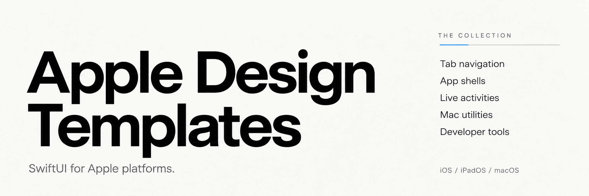
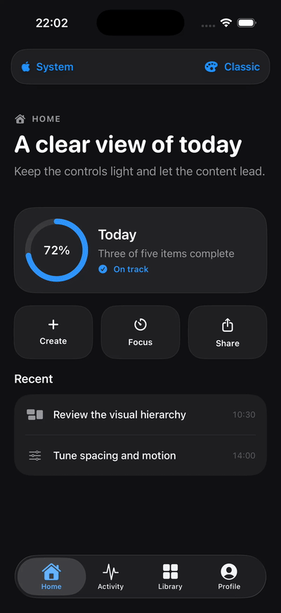
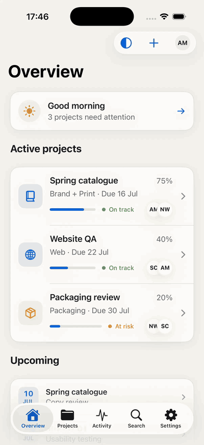
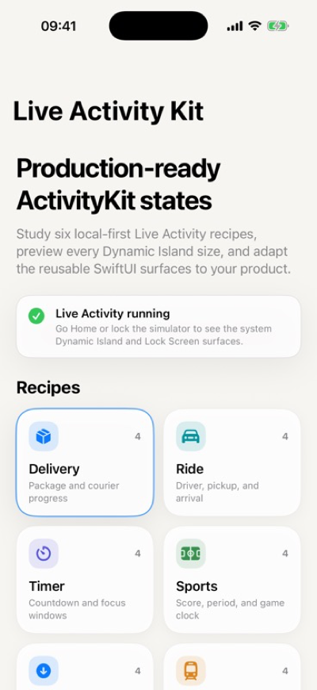
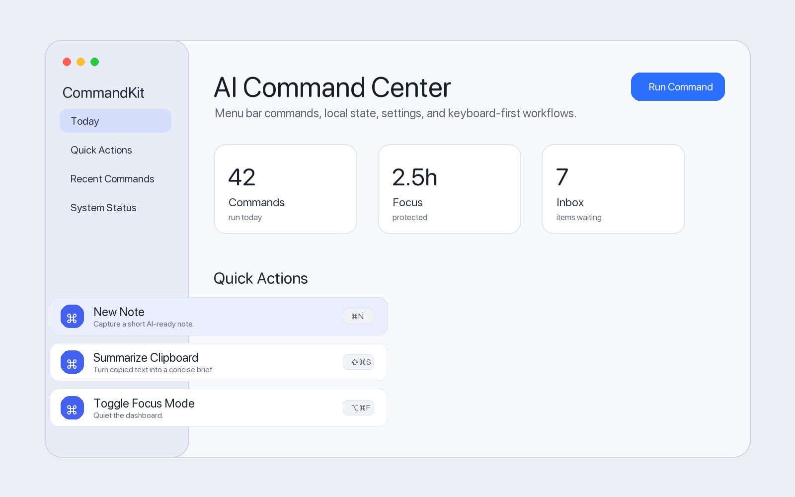
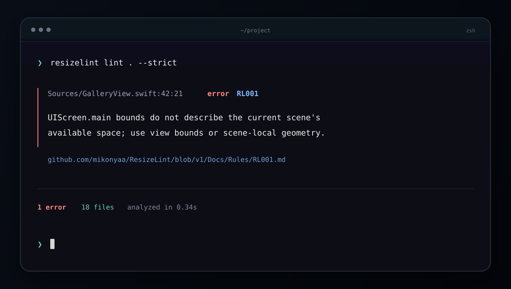

<div align="center">
  <a href="#choose-by-outcome"></a>
  <h1>Apple Design Templates</h1>
  <p><strong>Focused SwiftUI starting points for Apple-platform products.</strong></p>
  <p>Choose a project. Inspect its demo and limitations. Adapt only what you need.</p>
  <p>Curated by <a href="https://github.com/mikonyaa"><strong>miko.os</strong></a> · <a href="LICENSE">MIT</a></p>
  <p><a href="README.ru.md">Русская версия</a></p>
</div>

Four independent SwiftUI templates and one developer tool. Each project owns its implementation, documentation, issues, tests, and release history.

<!-- catalog:begin -->

## Choose by outcome

- **Improve tab navigation in an existing iOS app** → [Liquid Glass Tab Bars](#liquid-glass-tab-bars) · 1.0.3
- **Define navigation for a new iPhone and iPad product** → [Adaptive App Shell](#adaptive-app-shell) · 1.0.3
- **Show glanceable status on the Lock Screen and Dynamic Island** → [Live Activity & Dynamic Island Kit](#live-activity-dynamic-island-kit) · 0.1.0
- **Build a focused Mac menu bar utility** → [Mac Menu Bar Command Kit](#mac-menu-bar-command-kit) · 0.2.0
- **Find non-adaptive Swift and UIKit assumptions before runtime QA** → [ResizeLint](#resizelint) · 1.0.0

Pick the smallest package that owns your problem. The four UI templates are independent; ResizeLint can be used separately.

**Released** means a published release at the named tag. **Preview** means unreleased or prerelease work. **Verified scope** states only the checks actually performed; source review and CI do not establish device or production behavior.

## Templates

<a name="liquid-glass-tab-bars"></a>

### Liquid Glass Tab Bars

> **Released 1.0.3** · iOS 17+; macOS 14+ (package) · Swift 6.0; Xcode 26+ for native Liquid Glass

Three tab-bar approaches around one selection model: system, floating, and morphing.

<p align="center">
  <a href="Assets/liquid-glass-tab-bars.gif">
    
  </a>
</p>

[Watch the original animation](Assets/liquid-glass-tab-bars.gif)

**When a simpler solution is enough:** Use the system TabView when it already meets your needs.

- The source provides custom variants for 2–5 destinations, accessibility settings, and guarded iOS 26 styling.

**Limits:**

- Use system navigation for more than five destinations. Earlier OS versions use fallbacks; device accessibility has not been independently checked here.

**Verified scope · source-review · 2026-10-14:** Release metadata and versioned source; linked CI is upstream evidence. No independent device or production test.

[Repository](https://github.com/mikonyaa/LiquidGlassTabBars) · [Release 1.0.3](https://github.com/mikonyaa/LiquidGlassTabBars/releases/tag/1.0.3) · [Versioned docs](https://github.com/mikonyaa/LiquidGlassTabBars/tree/828ded25395e66fa7640d496ecc18cc83e6b1777/Docs) · [Evidence and scope](Docs/Catalog-evidence.md#liquid-glass-tab-bars)

---

<a name="adaptive-app-shell"></a>

### Adaptive App Shell

> **Released 1.0.3** · iOS 17+; macOS 14+ (package) · Swift 6.0; Xcode 26+

A shared state model for compact tabs, a regular-width sidebar, and an optional inspector.

<p align="center">
  <a href="Assets/adaptive-app-shell.gif">
    
  </a>
</p>

[Watch the original animation](Assets/adaptive-app-shell.gif)

**When a simpler solution is enough:** Skip a full shell when an existing app only needs a tab-bar component.

- The source includes per-destination navigation paths, enum-based deep links, and three semantic themes.

**Limits:**

- The demo Create action only dismisses its sheet; it does not add or persist a project. Supply your own business model and persistence.

**Verified scope · source-review · 2026-10-14:** Release metadata and versioned source; linked CI is upstream evidence. No independent device or production test.

[Repository](https://github.com/mikonyaa/AdaptiveAppShell) · [Release 1.0.3](https://github.com/mikonyaa/AdaptiveAppShell/releases/tag/1.0.3) · [Versioned docs](https://github.com/mikonyaa/AdaptiveAppShell/tree/ed5cc9573a7258cc2549125d538102c9029e753a/Docs) · [Evidence and scope](Docs/Catalog-evidence.md#adaptive-app-shell)

---

<a name="live-activity-dynamic-island-kit"></a>

### Live Activity & Dynamic Island Kit

> **Released 0.1.0** · iOS 17+; macOS 14+ (package) · Swift 6.0; Xcode 16.4+

A domain-neutral rendering core with Activity Lab examples and an app-owned ActivityKit lifecycle.

<p align="center">
  <a href="https://github.com/mikonyaa/LiveActivityDynamicIslandKit">
    
  </a>
</p>

**When a simpler solution is enough:** Skip ActivityKit when status only needs to appear inside the app.

- The source contains Lock Screen and compact, minimal, expanded Dynamic Island views plus start, update, recovery, and end examples.

**Limits:**

- Selecting another scenario can update content while the active activity keeps its original attributes. End and restart the activity when changing scenario; device lifecycle is unverified here.

**Verified scope · source-review · 2026-10-14:** Release metadata and versioned source; linked CI is upstream evidence. No independent device or production test.

[Repository](https://github.com/mikonyaa/LiveActivityDynamicIslandKit) · [Release 0.1.0](https://github.com/mikonyaa/LiveActivityDynamicIslandKit/releases/tag/0.1.0) · [Versioned docs](https://github.com/mikonyaa/LiveActivityDynamicIslandKit/tree/f577568f466136e28da427e55aa639170fafbac6/Docs) · [Evidence and scope](Docs/Catalog-evidence.md#live-activity-dynamic-island-kit)

---

<a name="mac-menu-bar-command-kit"></a>

### Mac Menu Bar Command Kit

> **Released 0.2.0** · macOS 14+ · Swift 6.0; Xcode 26+

A keyboard-first command shell for focused macOS utilities.

<p align="center">
  <a href="https://github.com/mikonyaa/MacMenuBarCommandKit">
    
  </a>
</p>

**When a simpler solution is enough:** Skip a command shell for a single standard MenuBarExtra menu.

- The source includes MenuBarExtra, a main window, command palette, Settings, Launch at Login integration, and clipboard handlers.

**Limits:**

- Start Timer increments focus minutes and sets a flag; it does not measure elapsed time. Implement a real timer in the app.

**Verified scope · source-review · 2026-10-14:** Release metadata and versioned source; linked CI is upstream evidence. No independent device or production test.

[Repository](https://github.com/mikonyaa/MacMenuBarCommandKit) · [Release 0.2.0](https://github.com/mikonyaa/MacMenuBarCommandKit/releases/tag/0.2.0) · [Versioned docs](https://github.com/mikonyaa/MacMenuBarCommandKit/tree/ab43ae5d750f1005ee3e704b3756f4af8c2b3a37/Docs) · [Evidence and scope](Docs/Catalog-evidence.md#mac-menu-bar-command-kit)

---

## Developer tool

<a name="resizelint"></a>

### ResizeLint

> **Released 1.0.0** · macOS 14+; Ubuntu 22.04+ x86_64 with Swift runtime · Swift 6.3.3 (source build)

A local CLI for detecting global screen, scene, device idiom, orientation, and layout assumptions.

<p align="center">
  <a href="https://github.com/mikonyaa/ResizeLint">
    
  </a>
</p>

**When a simpler solution is enough:** Static diagnostics complement resizing and device QA; they cannot prove runtime layout correctness.

- The source defines nine rules, human/Xcode/JSON/SARIF output, and a checksum-verifying Action. Source stays local during analysis.

**Limits:**

- The published Linux 1.0.0 archive needs Swift shared libraries including libswiftCore.so; a clean Ubuntu install alone is insufficient. macOS signing/notarization is evidenced by release CI, not an independent Gatekeeper check in this catalog.

**Verified scope · source-review · 2026-10-14:** Release metadata and versioned source; linked CI is upstream evidence. No independent device or production test.

[Repository](https://github.com/mikonyaa/ResizeLint) · [Release 1.0.0](https://github.com/mikonyaa/ResizeLint/releases/tag/1.0.0) · [Versioned docs](https://github.com/mikonyaa/ResizeLint/tree/cde1a7b5165cd6dc225166e6e0a7614a32ebce28/Docs) · [Evidence and scope](Docs/Catalog-evidence.md#resizelint)

---

<!-- catalog:end -->

## Quality criteria by role

These are maintenance criteria, not a blanket guarantee that every demo scenario is finished:

- **UI templates:** a focused reusable package, explicit Apple-platform requirements, a demo with local data, accessibility and fallback guidance, tests, versioned docs, and real preview captures. The reusable package manifests declare no third-party Swift dependencies; demo build tooling is a separate concern.
- **CLI tooling:** reproducible fixtures, deterministic reports, documented source dependencies and platform runtime requirements, checksums, and distribution evidence. ResizeLint uses SwiftSyntax, ArgumentParser, and Yams; a Linux binary may require Swift shared libraries.
- **Catalog:** consistent EN/RU facts, traceable claims, correct support routes, intact local links, and an enforced media byte budget. Catalog CI checks these facts; upstream CI and device acceptance have their own scopes.

## Use a template in three steps

1. Choose the smallest repository that matches the product problem.
2. Read its versioned docs, run its demo in the required environment, and check the listed limitations.
3. Keep business models, persistence, and platform side effects in your app when adapting the package.

## Maintain the catalog

Run the offline check with Python 3.10+:

```sh
python3 Scripts/verify-catalog.py
python3 Scripts/test-verify-catalog.py
```

Use `python3 Scripts/verify-catalog.py --online` to explicitly re-check releases and immutable commits. Unavailable network or rate limits report **UNVERIFIED** with a nonzero exit; the command never rewrites catalog facts.

[Maintenance and media measurements](Docs/Catalog-maintenance.md) · [Evidence and scope](Docs/Catalog-evidence.md) · [Independent selection-test protocol](Docs/Selection-test.md)

Catalog structure, broken catalog links, and collection proposals belong in [catalog Issues](https://github.com/mikonyaa/Apple-Design-Templates/issues). Implementation and integration questions belong in the relevant project; see [Contributing](CONTRIBUTING.md). Follow the affected project's [security policy](SECURITY.md) for vulnerability reports.

---

<div align="center">
  <p><a href="CONTRIBUTING.md">Contributing</a> · <a href="SECURITY.md">Security</a> · <a href="LICENSE">MIT License</a></p>
  <p>Built and maintained by <a href="https://github.com/mikonyaa"><strong>miko.os</strong></a>.</p>
</div>
